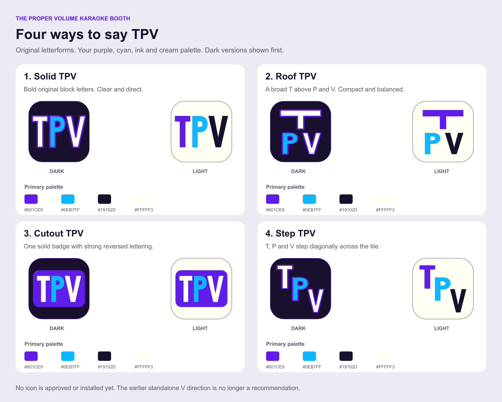
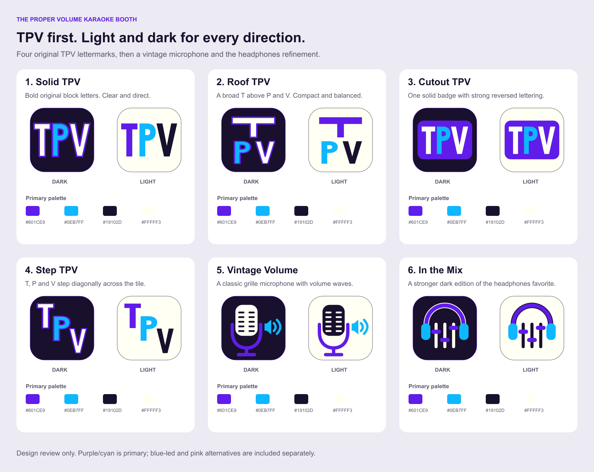
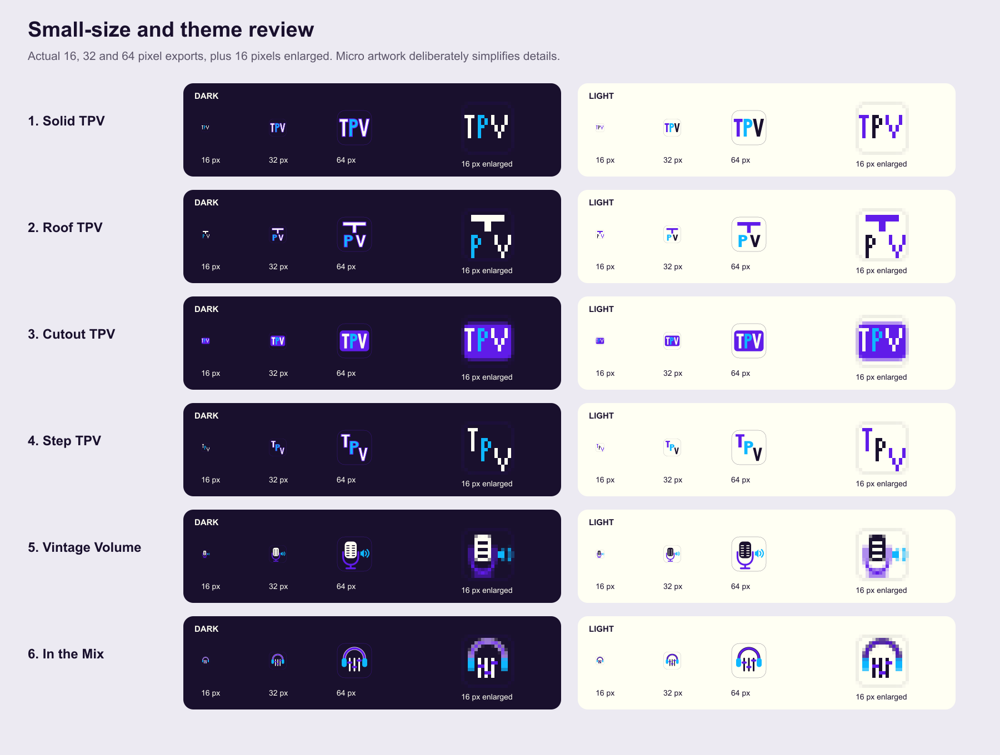
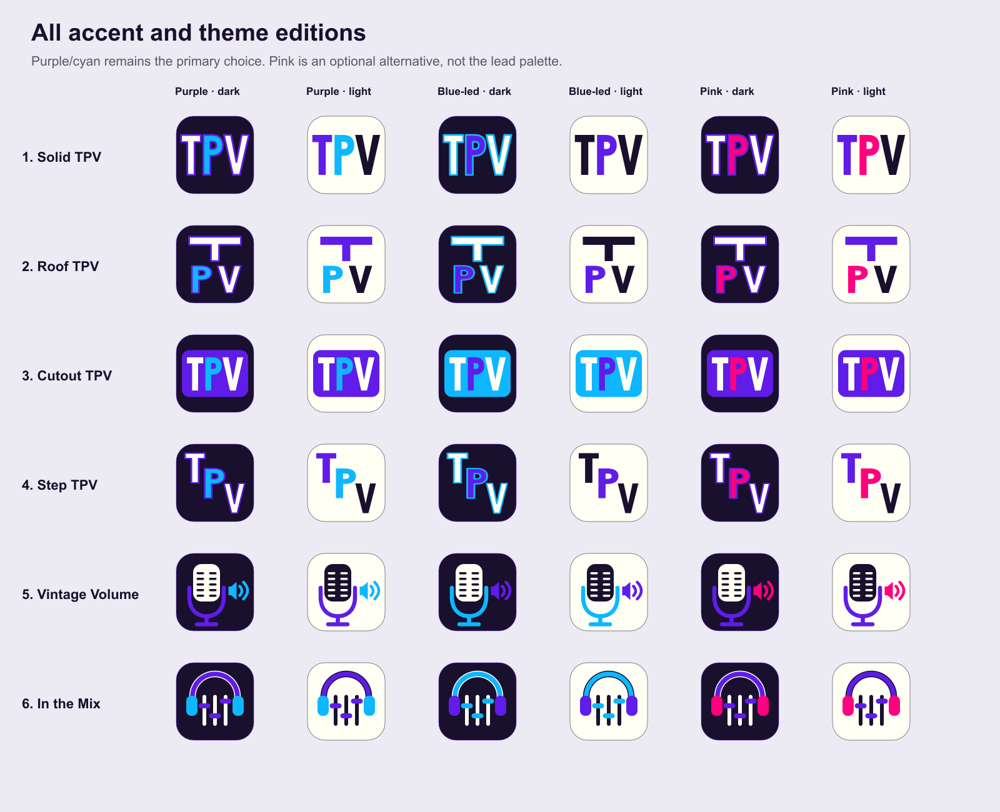

# Application icon options

Updated 13 November 2026. The owner has selected the supplied **Microphone Play** reference (`mic-play`) as the provisional identity for the next pre-release. The vintage microphone and play outline supersede the 12 November Velvet Script selection. The application name remains The Proper Volume Karaoke Booth.

The reference palette is orange `#F68713`, pink `#ED0D63`, navy `#131457` and gray `#E9E9E9`, with dark and light editions required. The app icon must contain **no visible text**. The full logo reads **TPV / KARAOKE BOOTH**, correcting the reference's extra E. Earlier concepts and palettes below remain exploration history.

## Selected Pre-release Identity

The maintained [asset set and reproduction instructions](../assets/branding/README.md) cover SVG masters, logos and wordmarks, Windows ICO, macOS ICNS, Linux PNGs, web favicons and mobile/adaptive icons. All 69 generated hashes, platform icon containers and Windows resource checks passed. The default installed icon uses the original navy mark on a white rounded tile; the dark edition has a contrast keyline. Windows 0.4.1 includes the new app/setup/uninstaller icons and assisted-installer artwork. The actual upgrade on this PC and private-profile Day/Night host-logo checks passed. Linux 0.4.1 AppImage/Debian packages also passed matching-payload, default-icon, packaged-logo/favicon and extracted AppRun checks; see [installation evidence](installation.md).

The desktop packaging and runtime use the shared branding paths for the executable, installer, launcher, Host and Singer Display windows; the mobile preview has corresponding icon paths. Existing custom singer-display logos remain independent. Older generated installers retain their prior identity. Exporting an ICNS or configuring a macOS target does not establish a native Mac build.

## Four TPV directions

The TPV paths and compositions are original. KaraFun was a category reference for a strong, compact lettermark; its K mark and letter geometry were not reused.

| Option | Direction | Reason to choose it | Tradeoff |
| --- | --- | --- | --- |
| **1. Solid TPV** | Three bold original block letters | The clearest literal TPV reading. Recommended starting point when recognition matters most. | A compact wordmark is less abstract than a single monogram shape. |
| **2. Roof TPV** | A broad T over P and V | A more compact, distinctive composition. Recommended alongside Solid TPV for the next comparison. | The stacked reading needs a moment more at the smallest sizes. |
| **3. Cutout TPV** | Reversed letters inside one solid badge | Strong contrast and a connected overall shape in either theme. | Its inner badge adds another frame. This is a new TPV option, not the rejected standalone V. |
| **4. Step TPV** | T, P and V on a diagonal | A more energetic arrangement that fills the tile vertically. | The reading order is less immediate than Solid TPV. |

## Vintage microphone and headphones alternatives

The requested microphone direction now uses an upright vintage grille, a supporting yoke and stand, and a speaker with volume waves. The headphones direction keeps the earlier faders idea while adding a much stronger dark edition. Both use the same primary palette and both include light and dark versions.

| Option | Direction | Reason to choose it | Tradeoff |
| --- | --- | --- | --- |
| **5. Vintage Volume** | Vintage microphone with volume symbols | The clearest karaoke reference, with the requested older microphone styling. | Grille and volume detail must simplify at 16 pixels. |
| **6. In the Mix** | Headphones surrounding mixer faders | Continues the earlier favorite with stronger contrast and an ink-tile edition. | More internal detail than the TPV directions. |

## Small sizes and alternate accents

The review shows actual 16-, 32- and 64-pixel exports against their theme backgrounds, followed by enlarged 16-pixel samples. The micro versions use deliberate pixel-grid letterforms or simplified microphone/fader details. Light TPV micro exports use darker letter colors to maintain recognition. These are visual export checks, not claims that taskbar or dock integration has been verified in the installed app.

All six directions also have blue-led and optional pink editions, each in light and dark. The app's interface accent button does not automatically change the installed application icon.

## Editable primary sources

| Direction | Dark edition | Light edition |
| --- | --- | --- |
| Solid TPV | [SVG](../design/app-icon-options/2026-11-12-tpv/01-solid-tpv-dark.svg) | [SVG](../design/app-icon-options/2026-11-12-tpv/01-solid-tpv-light.svg) |
| Roof TPV | [SVG](../design/app-icon-options/2026-11-12-tpv/02-roof-tpv-dark.svg) | [SVG](../design/app-icon-options/2026-11-12-tpv/02-roof-tpv-light.svg) |
| Cutout TPV | [SVG](../design/app-icon-options/2026-11-12-tpv/03-cutout-tpv-dark.svg) | [SVG](../design/app-icon-options/2026-11-12-tpv/03-cutout-tpv-light.svg) |
| Step TPV | [SVG](../design/app-icon-options/2026-11-12-tpv/04-step-tpv-dark.svg) | [SVG](../design/app-icon-options/2026-11-12-tpv/04-step-tpv-light.svg) |
| Vintage Volume | [SVG](../design/app-icon-options/2026-11-12-tpv/05-vintage-volume-dark.svg) | [SVG](../design/app-icon-options/2026-11-12-tpv/05-vintage-volume-light.svg) |
| In the Mix | [SVG](../design/app-icon-options/2026-11-12-tpv/06-in-the-mix-dark.svg) | [SVG](../design/app-icon-options/2026-11-12-tpv/06-in-the-mix-light.svg) |

Each source has a corresponding `-small.svg` in the same directory. The accompanying review ZIP contains all **36** direction/theme/palette editions: six directions, two themes and three palettes. Each edition includes editable SVG, micro SVG, PNGs at 16, 24, 32, 48, 64, 128, 256, 512 and 1024 pixels, and a Windows ICO with sizes 16 through 256. Native vector construction was used to control letter geometry and small-size rendering; no raster-generation service was used.

The options above are historical alternatives. Velvet Script was selected on 12 November from a later vintage/cursive review, then superseded by Microphone Play on 13 November. Its Lobster lettering and purple/cyan palette are historical, not instructions for the new mark. Retain the existing sources and licenses. Windows package resources and Start menu references are verified; remaining taskbar/desktop, Linux launcher and light/dark Dock appearance still need checks on their target systems.

## Earlier review retained as history

The [earlier comparison](../design/app-icon-options/2026-11-12/comparison.png), [earlier size review](../design/app-icon-options/2026-11-12/size-review.png) and their editable sources remain available. The earlier **standalone Volume V is rejected** and must not be used as the current recommendation. The original headphones and modern-microphone sketches remain historical references; the current alternatives above apply the later theme, microphone and color feedback.
