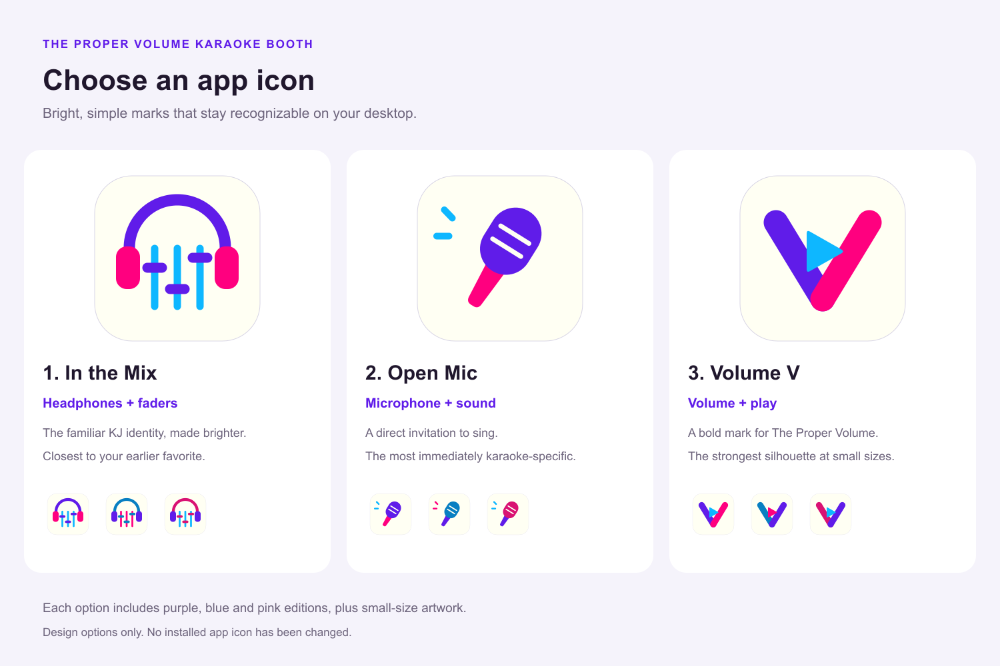
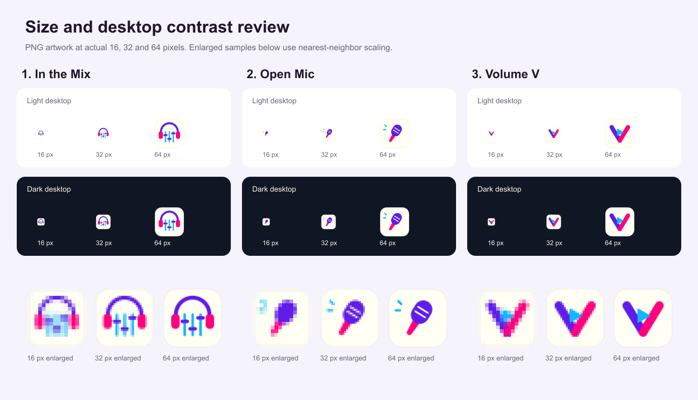

# Application icon options

Prepared 12 November 2026 for The Proper Volume Karaoke Booth. These are **design options**, with no final selection yet. The application name and packaged icon have not changed.

The earlier bright headphones-and-faders concept is retained as a reference. All three directions use the project's cream, purple, pink and blue palette, with a strong mark instead of small lettering. They include three accent editions; the interface's accent-color button does not automatically change the installed application icon.

| Option | Direction | Why choose it | Tradeoff |
| --- | --- | --- | --- |
| **1. In the Mix** | Headphones surrounding mixer faders | Continues the earlier favorite, with a brighter tile and heavier small-size details. Recommended for continuity with the existing KJ direction. | Three faders make it busier at 16 pixels than the other directions. |
| **2. Open Mic** | Diagonal microphone with sound marks | The most immediately recognizable karaoke symbol. Its handle, grille and sound accents keep the palette lively. | A microphone is a familiar category symbol rather than a unique brand initial. |
| **3. Volume V** | A bold V with a play triangle | A distinctive mark for The Proper Volume, with the clearest overall silhouette at small sizes. | It needs the application name beside it to communicate karaoke explicitly. |

## Small-size and contrast review

The comparison below shows actual 16-, 32- and 64-pixel PNGs against light and dark surfaces, followed by enlarged pixel samples. The 16- and 24-pixel headphones use heavier controls; the microphone omits its grille at those sizes. The V retains its simple geometry. This is visual review of the exports, not a claim that Windows taskbar, Linux desktop or macOS integration has been tested.

Editable purple-edition sources are maintained with this document:

- [In the Mix](../design/app-icon-options/2026-11-12/01-in-the-mix.svg) and its [small-size source](../design/app-icon-options/2026-11-12/01-in-the-mix-small.svg).
- [Open Mic](../design/app-icon-options/2026-11-12/02-open-mic.svg) and its [small-size source](../design/app-icon-options/2026-11-12/02-open-mic-small.svg).
- [Volume V](../design/app-icon-options/2026-11-12/03-volume-v.svg) and its [small-size source](../design/app-icon-options/2026-11-12/03-volume-v-small.svg).

## Export package and next step

The accompanying review ZIP contains all three concepts in purple, blue and pink editions. Each edition has editable SVG, small-size SVG, PNGs at 16, 24, 32, 48, 64, 128, 256, 512 and 1024 pixels, and a Windows ICO containing sizes 16 through 256. The assets were drawn as native SVG to preserve the existing brand geometry and control small-size rendering; no raster-generation service was used.

After a direction is selected, use its ICO for Windows and its PNGs for Linux, produce and verify the macOS icon package on a Mac, and check taskbar, Start menu, desktop shortcuts and light/dark docks in the actual installed application. Add platform-specific optical adjustments if those checks reveal a problem. Unselected explorations must not become the release icon accidentally.
